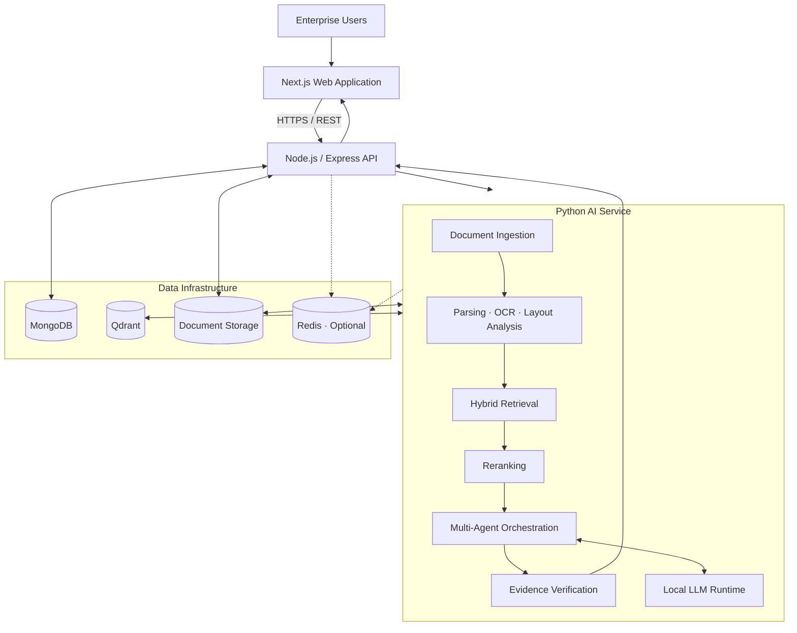

<h1 align="center">VeriCore AI 3.0</h1>

<p align="center">
  <strong>Multimodal Enterprise Knowledge Intelligence & Multi-Agent SOP Platform</strong>
</p>

<p align="center">
  <em>Evidence before answers.</em>
</p>

<p align="center">
  Understand complex documents. Retrieve connected knowledge.
  Generate answers grounded in verifiable evidence.
</p>

---

## Overview

Enterprise knowledge is scattered across policies, standard operating procedures, reports, scanned documents, tables, diagrams, forms, and other information sources.

Conventional document chatbots often struggle with this complexity, particularly when answers depend on document structure, visual information, cross-references, or conflicting sources.

**VeriCore AI** is being developed to address this challenge through multimodal document understanding, hybrid knowledge retrieval, coordinated AI workflows, and evidence-grounded answer generation.

The goal is not simply to generate answers, but to make organizational knowledge understandable, traceable, and verifiable.

## What Makes VeriCore Different?

| Conventional document chatbot | VeriCore AI vision |
|---|---|
| Primarily text-oriented | Multimodal document understanding |
| Basic similarity search | Hybrid text and visual retrieval |
| Generates answers | Generates evidence-grounded answers |
| Limited source traceability | Document, page, section and visual references |
| Single-step question answering | Specialized multi-agent workflows |
| May answer with insufficient evidence | Designed to communicate uncertainty and abstain |

## Core Capabilities

The following capabilities define the intended product scope and are under development.

### 01. Multimodal Document Intelligence

Understand complex enterprise information, including:

- Text, paragraphs and headings
- Tables and nested tables
- Scanned documents and forms
- Images, screenshots and charts
- Flowcharts, diagrams and visual workflows
- Structured records and cross-referenced content

### 02. Hybrid Knowledge Retrieval

Combine multiple retrieval approaches to locate relevant information across enterprise knowledge sources.

- Semantic vector search
- Lexical and keyword retrieval
- Reranking for relevance refinement
- Visual document retrieval
- Context-aware evidence selection

### 03. Evidence-Grounded Answer Generation

Generate responses using retrieved source material rather than unsupported assumptions.

- Traceable source references
- Page and section-level citations
- Table and figure references
- Evidence inspection
- Uncertainty communication
- Abstention when sufficient evidence is unavailable

### 04. Multi-Agent Intelligence

Coordinate specialized AI workflows for complex knowledge tasks.

- Query understanding
- Retrieval planning
- Document analysis
- Evidence verification
- SOP-oriented reasoning
- Answer quality evaluation

### 05. Enterprise Security

Build around enterprise security requirements from the beginning.

- Authentication and authorization
- Workspace isolation and tenant boundaries
- Role-based access control
- Audit logging
- Secure document handling
- Protection against malicious document instructions

---

## Architecture

VeriCore AI follows a modular monorepo architecture with separate application and AI-processing responsibilities.



See **[Architecture Documentation](docs/architecture.md)** for detailed component responsibilities, data flow, security boundaries, and engineering principles.

## Technology Stack

The current technology direction is based on open-source tools and local-first development.

| Layer | Technology | Purpose |
|---|---|---|
| Frontend | Next.js, React, TypeScript | Web application |
| UI | Tailwind CSS, shadcn/ui, Motion | Interface and interactions |
| Backend | Node.js, Express, TypeScript | Application API |
| AI service | Python, FastAPI | AI processing and orchestration |
| Application database | MongoDB | Application and workspace data |
| Vector database | Qdrant | Vector and multimodal retrieval |
| AI orchestration | LangGraph | Multi-agent workflows |
| Model runtime | Ollama | Local LLM inference |
| Document processing | PyMuPDF, Docling, OCR tools | Extraction and document understanding |

Technology selections remain subject to compatibility testing, evaluation, and hardware-aware benchmarking.

## Repository Structure

```text
VeriCore-AI/
│
├── apps/
│   ├── web/                  # Next.js frontend
│   └── api/                  # Express application API
│
├── services/
│   └── ai/                   # Python AI service
│
├── packages/
│   └── contracts/            # Shared TypeScript contracts
│
├── infrastructure/
│   ├── docker/               # Container configuration
│   └── scripts/              # Development utilities
│
├── tests/
│   ├── integration/          # Integration tests
│   ├── e2e/                  # End-to-end tests
│   └── evaluation/            # AI evaluation tests
│
├── docs/
│   └── architecture.md       # System architecture
│
├── .github/
│   ├── ISSUE_TEMPLATE/       # Structured issue forms
│   └── PULL_REQUEST_TEMPLATE.md
│
├── .gitignore
├── package.json
└── tsconfig.base.json
```

## Engineering Principles

VeriCore AI is being developed around six principles:

1. **Evidence before generation:** Every factual answer should be supported by retrieved evidence.
2. **Multimodal by design:** Understand document structure and visual information, not just extracted text.
3. **Security by design:** Protect organizational data through explicit access boundaries.
4. **Responsible AI:** Communicate uncertainty and avoid unsupported claims.
5. **Modular engineering:** Maintain clear boundaries between application, AI and infrastructure components.
6. **Measurable quality:** Evaluate retrieval relevance, citation correctness, answer faithfulness, performance and failure handling.

## Development Status

**Early development · Active engineering**

The repository is being developed incrementally.

The initial monorepo structure, frontend foundation, backend foundation, architecture documentation, and repository contribution templates are being established.

Document ingestion, multimodal retrieval, authentication, evidence verification, and multi-agent workflows remain part of the implementation roadmap.

The capabilities described above represent the intended product scope, not a claim that they are already operational.

## Development Roadmap

| Phase | Focus |
|---|---|
| 01 | Monorepo and application foundations |
| 02 | Backend architecture and shared contracts |
| 03 | Authentication, workspaces and authorization |
| 04 | Document ingestion and extraction |
| 05 | Hybrid retrieval and reranking |
| 06 | Evidence-grounded answer generation |
| 07 | Multi-agent orchestration and verification |
| 08 | Enterprise security, evaluation and optimization |

## Contributing

VeriCore AI is currently under active development.

Bug reports, improvement proposals, and technical discussions can be organized through GitHub Issues and Pull Requests.

Please review the repository's contribution templates before submitting changes.

## Project

**Maintained by:** [whiffCODE](https://github.com/whiffCODE)

**Repository:** [github.com/whiffCODE/VeriCore-AI](https://github.com/whiffCODE/VeriCore-AI)

**Product:** VeriCore AI 3.0

**Tagline:** Evidence before answers.

## License

All rights reserved.

No license has been granted for redistribution, modification, or commercial use. See the repository ownership and licensing terms before reusing any project material.
