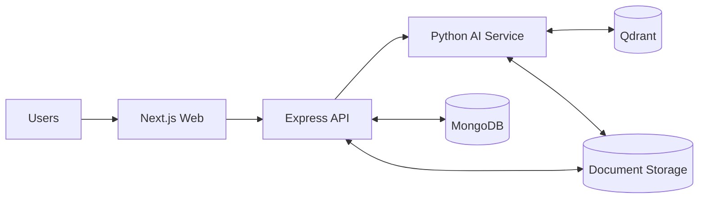

<p align="center">
  
</p>

<h1 align="center">VeriCore AI 3.0</h1>

<p align="center">
  <strong>Multimodal Enterprise Knowledge Intelligence & Multi-Agent SOP Platform</strong>
</p>

<p align="center">
  <em>Evidence before answers.</em>
</p>

<p align="center">
  Understand complex documents. Retrieve connected knowledge.
  Generate answers grounded in verifiable evidence.
</p>


# VeriCore AI 3.0

### Multimodal Enterprise Knowledge Intelligence & Multi-Agent SOP Platform

**Evidence before answers.**

VeriCore AI is an enterprise knowledge intelligence platform being developed to understand complex organizational documents, retrieve relevant information across multiple modalities, and generate answers grounded in verifiable evidence.

Unlike conventional document chatbots, VeriCore is designed around evidence traceability, document structure, contextual retrieval, and responsible AI reasoning.

---

## Vision

Organizations store critical knowledge across policies, standard operating procedures, reports, forms, tables, scanned documents, diagrams, and other unstructured sources.

VeriCore AI aims to make this information searchable, understandable, and verifiable through a unified knowledge platform.

## Core Capabilities (Planned)

- **Multimodal Document Understanding:** Process text, tables, scanned pages, images, charts, diagrams, and structured information.
- **Hybrid Retrieval:** Combine semantic, lexical, and visual retrieval strategies.
- **Evidence-Grounded Answers:** Connect generated claims to their original document locations.
- **Multi-Agent Workflows:** Coordinate specialized agents for retrieval, analysis, verification, and SOP-oriented tasks.
- **Evidence Inspection:** Trace answers to source documents, pages, sections, tables, and visual regions.
- **Enterprise Security:** Design for authentication, authorization, tenant isolation, and auditability.
- **Responsible AI:** Communicate uncertainty and abstain when the available evidence is insufficient.

## Technology Direction

| Layer | Selected technologies |
|---|---|
| Frontend | Next.js, React, TypeScript |
| UI | Tailwind CSS, shadcn/ui, Motion |
| Backend | Node.js, Express, TypeScript |
| AI service | Python, FastAPI |
| Application database | MongoDB |
| Vector database | Qdrant |
| AI orchestration | LangGraph |
| Local model runtime | Ollama |
| Document processing | PyMuPDF, Docling, OCR tooling |

Technology choices are subject to compatibility testing and hardware-aware benchmarking.

## Architecture

The project follows a modular monorepo architecture:

- `apps/web` – Web application.
- `apps/api` – Main application API.
- `services/ai` – Python-based AI processing service.
- `packages/contracts` – Shared application contracts.
- `infrastructure` – Deployment and infrastructure configuration.
- `tests` – Integration, end-to-end, and evaluation tests.

## Development Principles

1. Evidence before generation.
2. Security by design.
3. Modular and maintainable architecture.
4. Local-first development using open-source tools.
5. Measurable retrieval and answer quality.
6. Honest uncertainty and failure handling.

## Development Status

**Early development.**

The repository is being built incrementally. The architecture and technology direction are established, while application functionality, document processing, retrieval, authentication, and multi-agent workflows are being implemented and tested.

Planned capabilities should not be interpreted as completed features.

## Getting Started

Development setup instructions will be added as the application architecture stabilizes.

## Project Ownership

VeriCore AI is maintained by [whiffCODE](https://github.com/whiffCODE).

## License

All rights reserved. No license has been granted for redistribution or commercial use.


## Architecture at a Glance

VeriCore AI follows a modular architecture with a dedicated web
application, application API, and Python-based AI service.

See [Architecture Documentation](docs/architecture.md) for
component responsibilities, data flow, and security boundaries.



## Repository Structure

```text
VeriCore-AI/
├── apps/
│   ├── web/                 # Next.js frontend
│   └── api/                 # Express application API
├── services/
│   └── ai/                  # Python AI service
├── packages/
│   └── contracts/           # Shared TypeScript contracts
├── infrastructure/
│   ├── docker/
│   └── scripts/
├── tests/
│   ├── integration/
│   ├── e2e/
│   └── evaluation/
├── docs/
│   └── architecture.md
└── .github/
    ├── ISSUE_TEMPLATE/
    └── PULL_REQUEST_TEMPLATE.md
```

