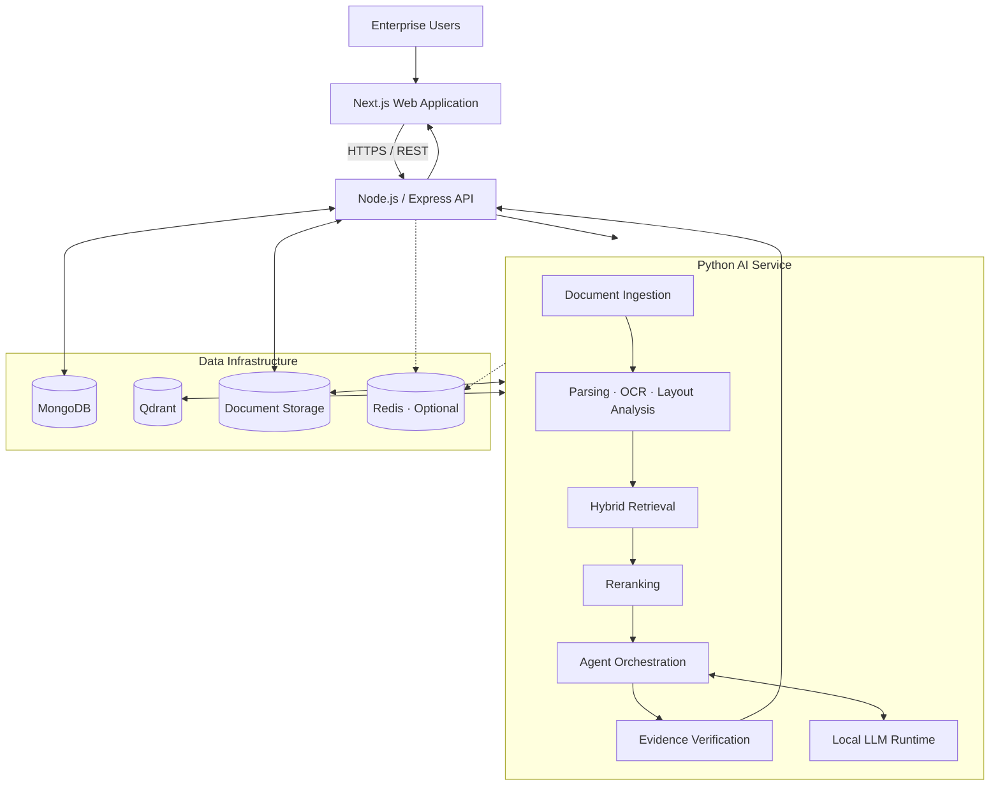

# VeriCore AI 3.0 Architecture

> Target architecture. Components are subject to implementation,
> compatibility testing, and performance benchmarking.

## System overview

## Application responsibilities

| Component | Responsibility |
|---|---|
| Web application | User interface, workspaces, document library, chat, evidence inspection |
| Application API | Authentication, authorization, tenant boundaries, business logic, audit events |
| AI service | Document understanding, retrieval, reranking, reasoning and verification |
| MongoDB | Users, workspaces, metadata, conversations and application records |
| Qdrant | Vector representations and retrieval indexes |
| Document storage | Original files and derived document artifacts |
| Redis | Optional caching and background-job coordination |

## Evidence-grounded processing flow

1. A user submits a document through the web application.
2. The application API validates permissions and records the upload.
3. The AI service extracts document structure and relevant visual content.
4. The ingestion pipeline creates searchable representations.
5. Retrieval combines appropriate text and visual search strategies.
6. Reranking selects the most relevant evidence.
7. Reasoning produces a candidate answer.
8. Verification checks the answer against retrieved evidence.
9. The API returns the answer with source references and uncertainty information.

## Security boundaries

- Authenticate users before accessing protected resources.
- Enforce workspace and tenant authorization on the server.
- Treat uploaded documents and extracted content as untrusted input.
- Keep credentials and secrets outside source control.
- Restrict access to original documents and derived artifacts.
- Record security-relevant operations in audit logs.

## Engineering principles

- Evidence before generation.
- Explicit service boundaries.
- Least-privilege authorization.
- Measurable retrieval and answer quality.
- Graceful failure and abstention.
- Resource-aware local inference.

## Implementation status

This document describes the intended architecture, not a claim that every component is implemented or production-ready.
